<div align="center">

# FinPilot

**Personal finance built on a ledger you can verify. It tells you how much of your money is actually free.**

Most expense trackers stop at "here is what you spent". FinPilot answers the question behind it:
_after the card bill, the rent due next week and the money I set aside, what can I actually use?_

Next.js 16 · React 19 · TypeScript (strict) · SQLite + Drizzle · Tailwind CSS 4 · Vitest · Playwright

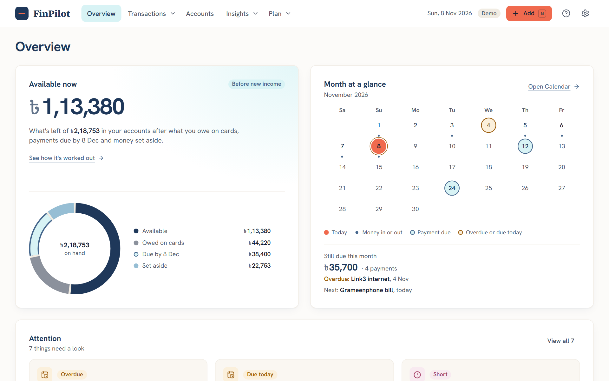

</div>

---

## Contents

- [What it does](#what-it-does)
- [Screenshots](#screenshots)
- [Engineering highlights](#engineering-highlights)
- [Architecture](#architecture)
- [Testing](#testing)
- [Running it locally](#running-it-locally)
- [Project status](#project-status)
- [Documentation](#documentation)

## What it does

FinPilot follows one loop: **Record → Verify → Understand → Available**. Each page owns one question
and answers it with figures that lead back to the transactions behind them.

| Page            | The question it answers                                                            |
| --------------- | ---------------------------------------------------------------------------------- |
| **Overview**    | What can I use right now, what needs me, and how does that sit against this month? |
| **Activity**    | What exactly happened? Search, filter and edit every transaction.                  |
| **Accounts**    | What do I have and owe, and can I still trust those balances?                      |
| **Cash flow**   | What happened to my money this month, and why did it change from last month?       |
| **Trends**      | Is this a pattern or a one-off, across six or twelve complete months?              |
| **Calendar**    | When did money move, and when do payments fall due?                                |
| **Commitments** | What am I already obligated to pay, and when?                                      |
| **Set aside**   | What have I reserved on purpose, and is that money still really there?             |
| **Available**   | How much can I use without touching money that's already spoken for?               |

Plus: a keyboard-first **Quick Add** (`N` from anywhere), an **Attention** list of ranked signals,
a step-by-step **Guide**, a JSON **backup** and a **CSV export** of transactions.
The demo is set in Bangladesh (taka, bKash, lakh grouping), and the money logic is currency-agnostic.

## Screenshots

### Available: how the free amount is worked out

Every deduction is a step you can see and trace: what's in your accounts, minus what you owe on cards,
minus payments due in the next 30 days, minus money set aside.

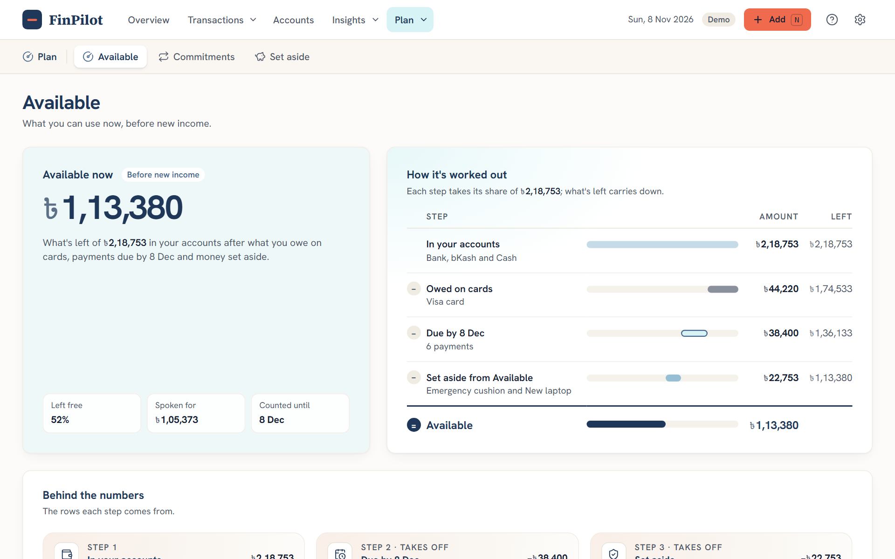

### Cash flow: what came in, where it went, and why it changed

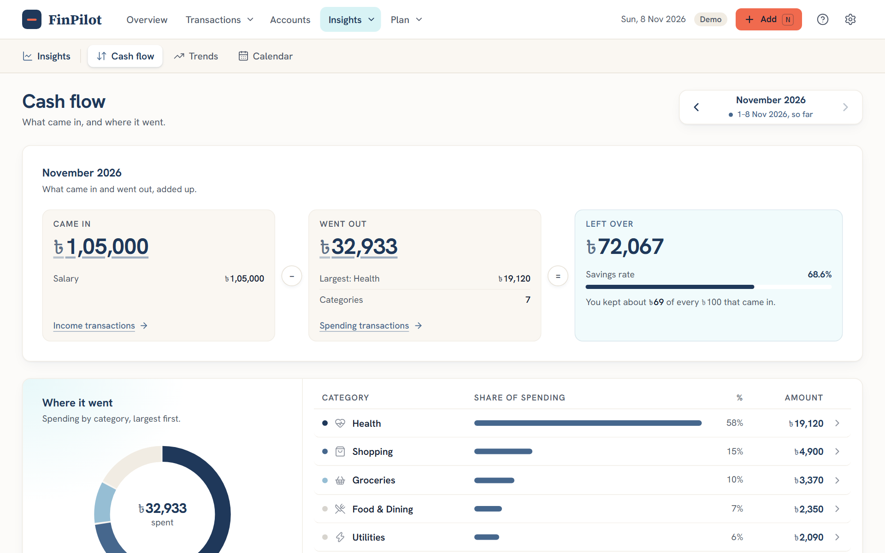

### Accounts: balances you can verify

Verify an account against reality. If the ledger disagrees, FinPilot records an adjustment.
If an entry dated before the last verification is edited later, the account shows as **Changed**.

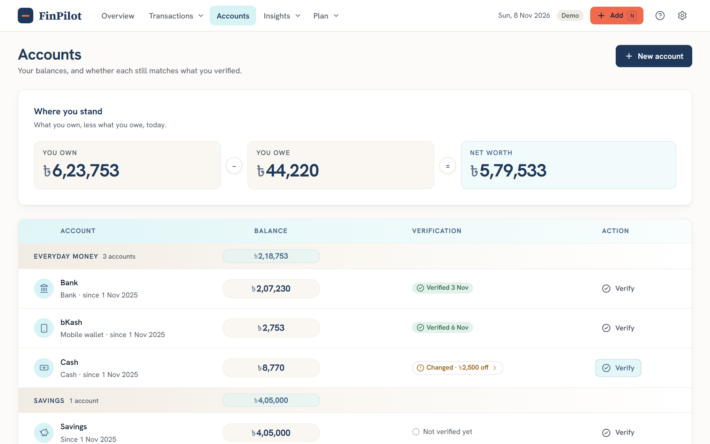

### Activity and Quick Add

| Every transaction, searchable, opens in a side panel                           | Quick Add: amount first, sensible defaults          |
| ------------------------------------------------------------------------------ | --------------------------------------------------- |
| 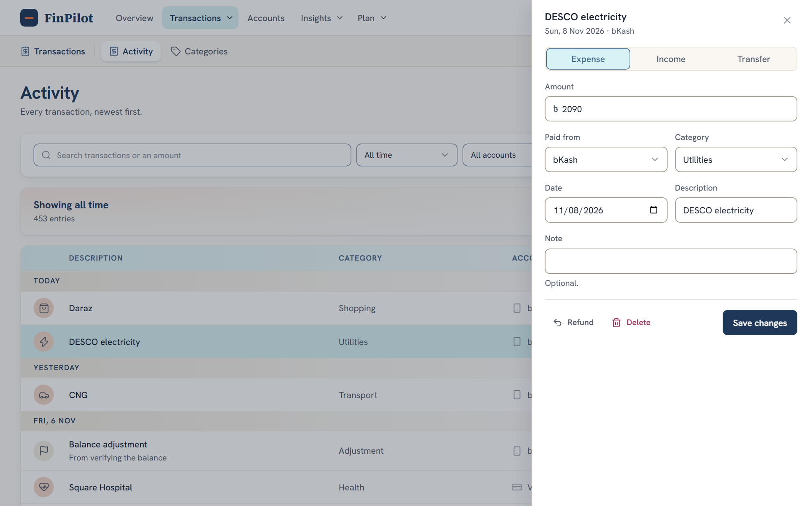 | 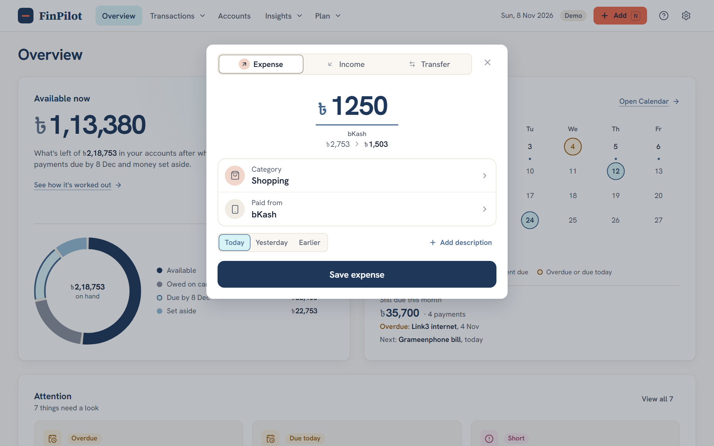 |

### Commitments, Set aside, Trends and Calendar

| Commitments                                                                               | Set aside                                                                                    |
| ----------------------------------------------------------------------------------------- | -------------------------------------------------------------------------------------------- |
| 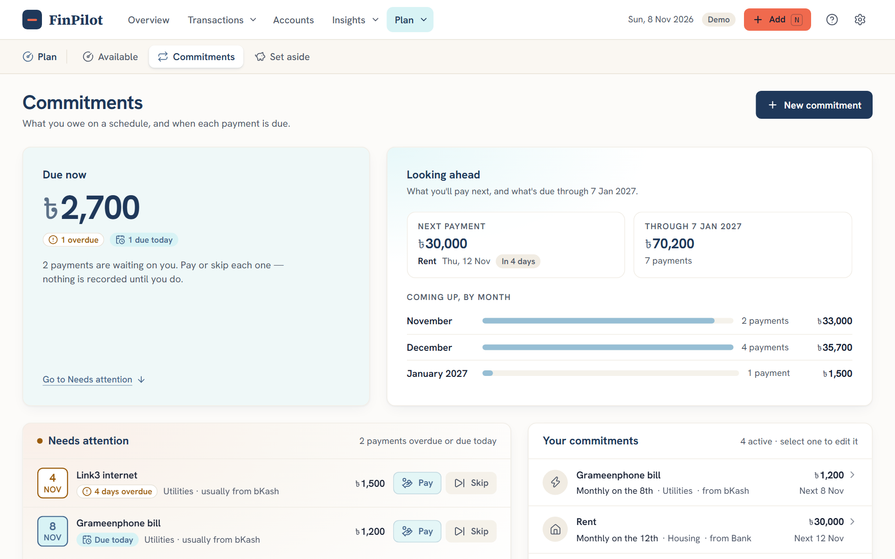 | 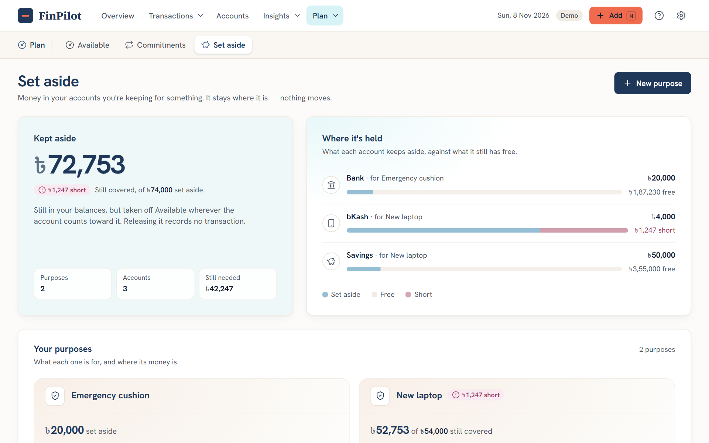 |
| **Trends**                                                                                | **Calendar**                                                                                 |
| 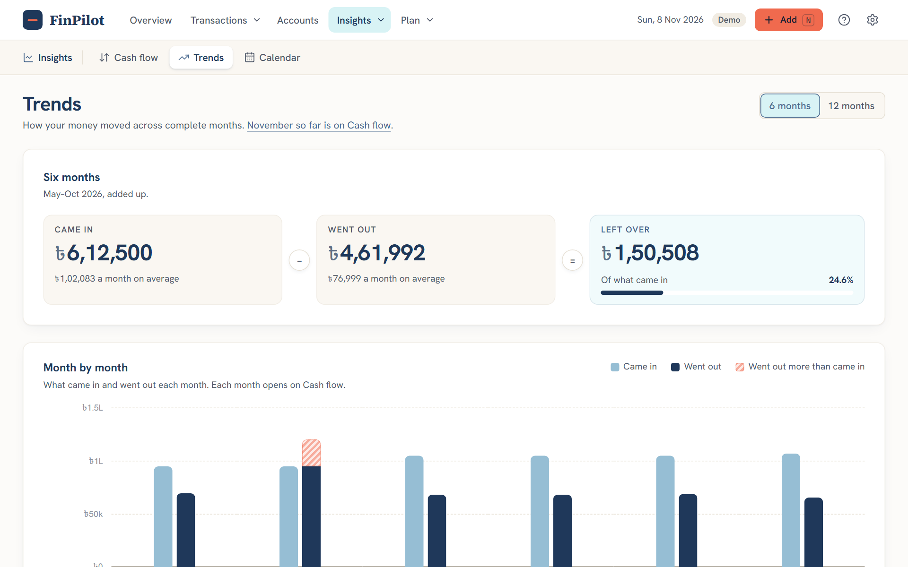               | 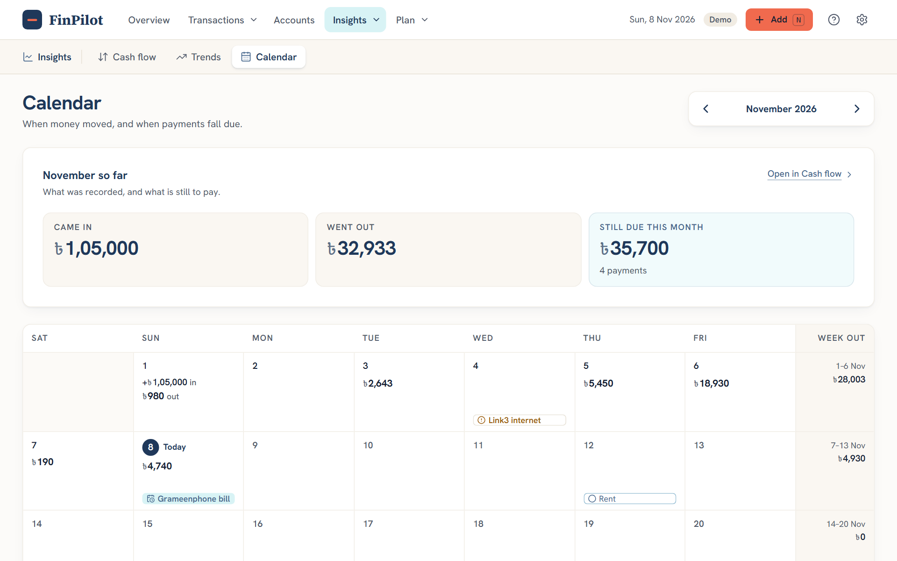             |

### On a phone

Every page is designed for 390 px and up, with a bottom bar and Quick Add one tap away.

|                                       Overview                                        |                                        Available                                        |                                        Quick Add                                        |
| :-----------------------------------------------------------------------------------: | :-------------------------------------------------------------------------------------: | :-------------------------------------------------------------------------------------: |
| 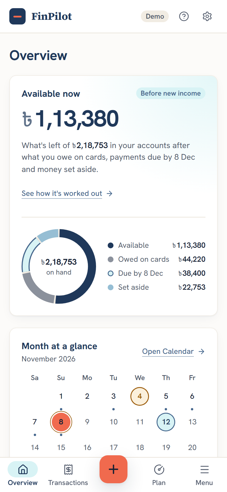 | 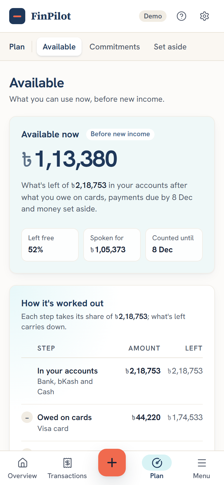 | 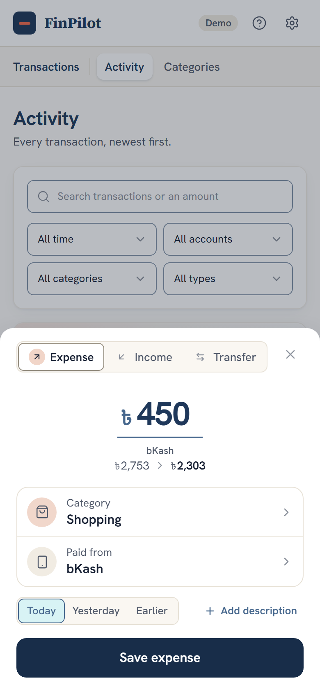 |

## Engineering highlights

**A derived ledger, not stored balances.** Transactions are the only financial truth. Balances,
net worth, Available, set-aside coverage and signals are all derived on every read, so they can't
drift out of sync with the history behind them. Every figure links to the rows it came from.

**Money is never a float.** Amounts are integer minor units (poisha) end to end, enforced by a
`CHECK (typeof(col) = 'integer')` in the database. Dates are ISO calendar dates with the
calendar logic in TypeScript, not in SQLite date functions, so moving to PostgreSQL stays mechanical.

**Available is a formula with invariants.**

```
Available = included asset balances
          + liability balances            (negative when owed, so debt is subtracted)
          − payments due in the next 30 days (overdue included)
          − set-aside money that is actually covered (never the nominal reserve)
```

The bridge checks on every read that its parts add up to the pool it divides. Subtracting
_covered_ rather than _reserved_ money is deliberate: a shortfall has already left the account,
so subtracting it again would count the same spending twice.
([domain-model.md §10](docs/domain-model.md))

**Verification that notices changed history.** A reconciliation checkpoint records "on this date
the real balance was X". If an entry on or before that date is edited or deleted later, the
account reads as _Changed_ by the exact difference, rather than silently disagreeing.

**Signals select and rank. They don't explain.** Attention items come from pure `rule(context) → Signal[]`
functions over the existing read models, in a fixed priority order. Each one opens the page that
owns the explanation. No scores and no AI-written filler.

**Architecture rules are enforced, not just documented.**

- `src/domain` is pure and deterministic: lint rejects framework, database and Node imports,
  `Date.now()` and randomness there ("today" comes from an injected clock), and `eslint-disable`
  has no effect inside it.
- Only repositories may open a database transaction. Services can't.
- `tests/architecture/` runs the real ESLint config against forbidden probes, so removing a rule
  turns the build red.

**Ready for more than one user.** Every table carries `owner_id`, IDs are UUIDv7, and owner
resolution goes through a single seam. V1 runs as one demo owner. Auth would plug in at that seam
without touching the ledger.

## Architecture

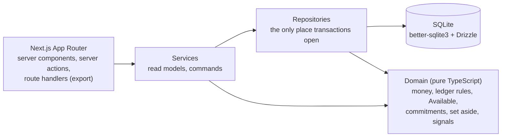

```
src/
  app/          routes, server actions, export route handlers
  components/   UI by feature (overview, available, activity, accounts, ...)
  domain/       framework-free financial core: ledger, available, commitments, protected money, signals
  server/       services (read models, commands) and repositories (SQL, transactions)
  db/           schema, migrations (with a hand-written view), demo seed
acceptance/     the frozen acceptance scenario, run against a real database
tests/          unit, component, server, database and architecture tests
e2e/            Playwright flows
docs/           product baseline, domain model, design direction, decisions and roadmap
```

Design decisions and their trade-offs are recorded in [docs/tech-stack.md](docs/tech-stack.md)
and [docs/domain-model.md](docs/domain-model.md). Examples: one row per transaction plus an
`account_entries` view instead of double-entry postings, better-sqlite3 for synchronous
transactions, and a rolling 30-day horizon instead of month end.

## Testing

| Layer                                                | What it covers                                                                                                                                                                                                                    |
| ---------------------------------------------------- | --------------------------------------------------------------------------------------------------------------------------------------------------------------------------------------------------------------------------------- |
| **Acceptance** (`acceptance/`)                       | A frozen September 2026 scenario. Every number in [acceptance-scenarios.md](docs/acceptance-scenarios.md) must be reproduced exactly, through the real services and a real migrated SQLite database, with no mocked repositories. |
| **Unit and property** (`tests/domain`)               | Money, dates, ledger rules, Available and backing, with `fast-check` properties for the invariants.                                                                                                                               |
| **Server and database** (`tests/server`, `tests/db`) | Commands, read models, constraints, rollbacks and migrations.                                                                                                                                                                     |
| **Components** (`tests/components`)                  | Rendering and copy for each page's states.                                                                                                                                                                                        |
| **Architecture** (`tests/architecture`)              | The domain boundary, determinism and transaction boundary rules.                                                                                                                                                                  |
| **End to end** (`e2e/`)                              | 130 Playwright flows against a production build: recording, editing, verifying, paying commitments, export, navigation and layout at phone, tablet and desktop widths.                                                            |

About 1,150 Vitest tests and 130 Playwright flows. `npm run check` runs format, lint,
typecheck, the schema check and every Vitest suite.

## Running it locally

Requires **Node.js 22 (≥ 22.12) or 24 LTS** (24 recommended; see `.nvmrc`) and npm.

```bash
npm install
npm run db:reset   # creates data/finpilot.sqlite with a demo ledger dated relative to today
npm run dev        # http://localhost:3000
```

The demo ledger is regenerated relative to today's date, so it always shows a current month
with salary, spending, card debt, commitments due and money set aside.

| Command                       | Purpose                                                      |
| ----------------------------- | ------------------------------------------------------------ |
| `npm run dev`                 | Development server                                           |
| `npm run build` / `npm start` | Production build and server                                  |
| `npm test`                    | Vitest: unit, component, server, architecture and acceptance |
| `npm run check`               | Format check, lint, typecheck, schema check and tests        |
| `npm run db:reset`            | Recreate the database with the demo ledger                   |
| `npm run test:e2e`            | Playwright end-to-end flows                                  |

End-to-end tests use their own database (`data/e2e.sqlite`) and server on port 3100, so they never
touch your local ledger. They need the browser once: `npx playwright install chromium`.

## Project status

**V1 feature-complete.** Overview, Activity, Accounts with verification, Cash flow, Trends,
Calendar, Commitments, Set aside, Available, Attention, Categories, Guide, and backup and export.

**Next:** a transaction import pipeline, starting with CSV, where imported rows wait in a review
inbox and nothing reaches the ledger until you confirm it.

**Deliberately not built in V1:** classic budgets (a monthly plan was considered and cut),
restoring from a backup, and authentication (the owner seam is ready for it). See
[docs/roadmap.md](docs/roadmap.md).

## Documentation

- [Product baseline](docs/product-baseline.md): why FinPilot exists, the product model, what each feature owns
- [Domain model](docs/domain-model.md): transactions, balances, Available, commitments, set aside, signals
- [Technology stack](docs/tech-stack.md): architecture decisions and the PostgreSQL path
- [Design direction](docs/design-direction.md): the visual system and the reasons behind it
- [Acceptance scenarios](docs/acceptance-scenarios.md): the numbers the implementation must reproduce
- [Roadmap](docs/roadmap.md): stages, decisions and known limitations
